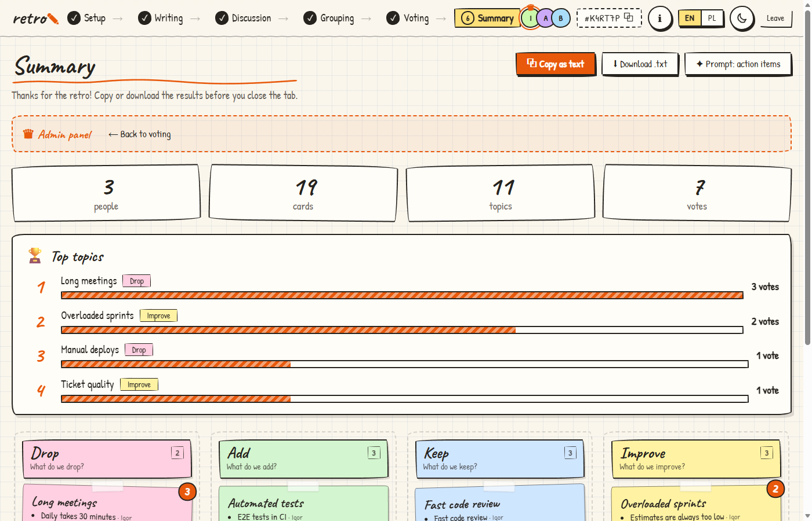
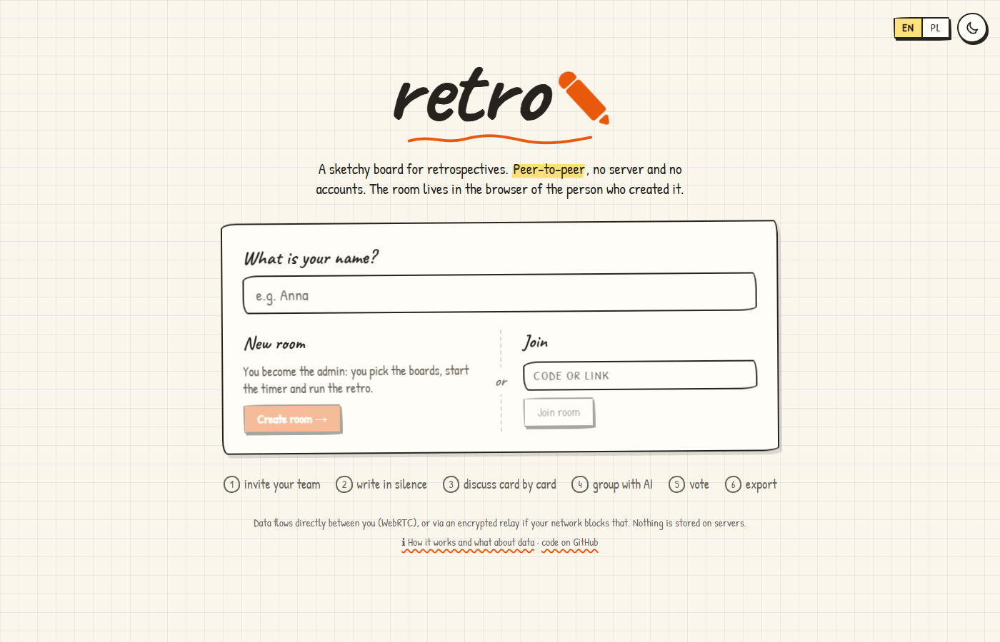
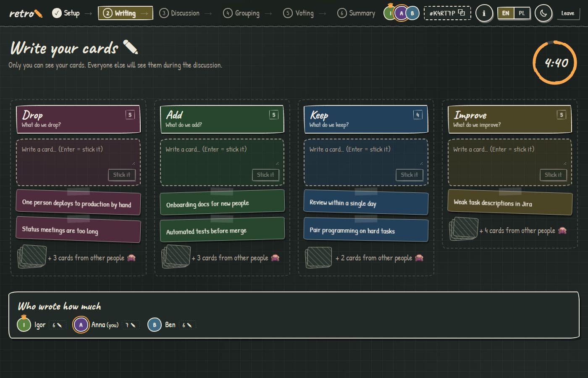
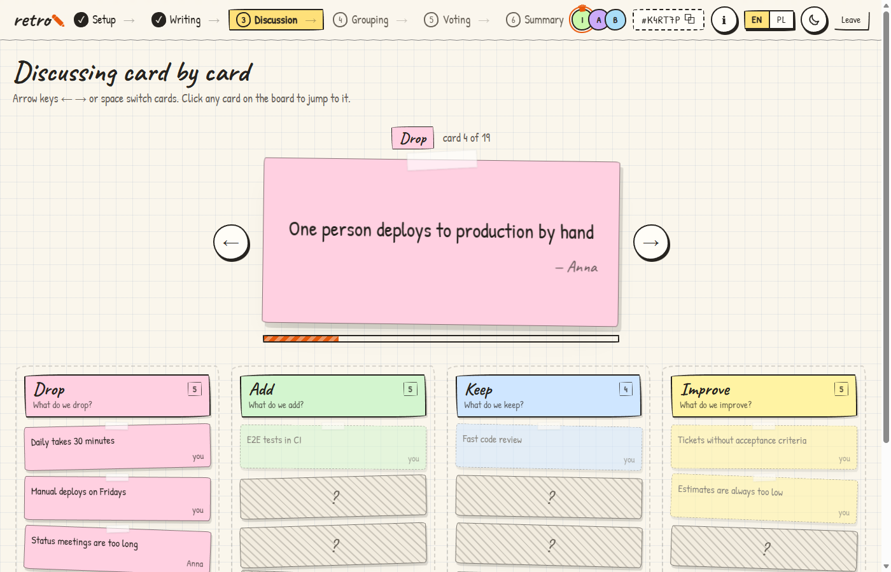
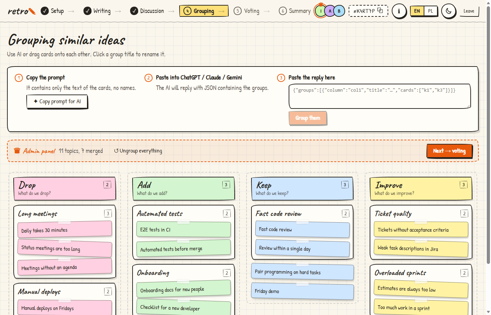
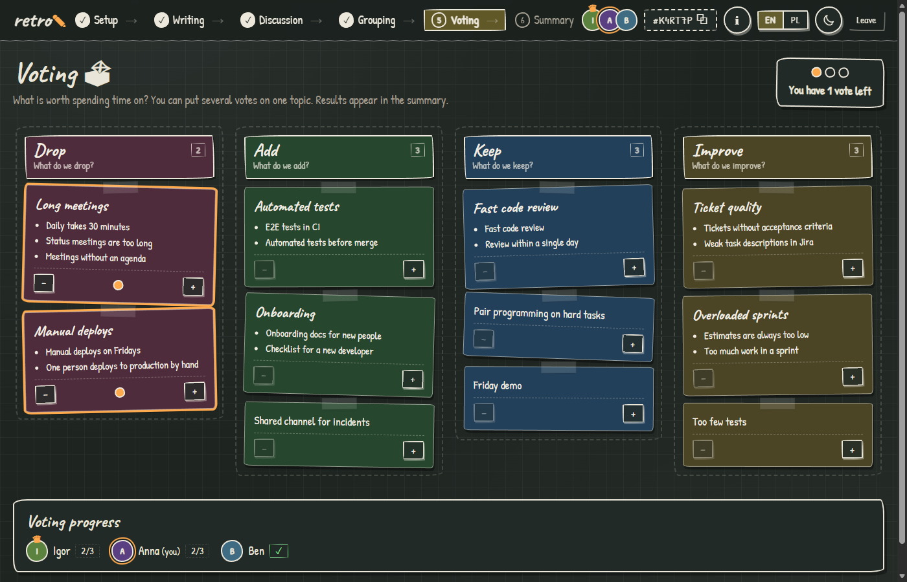

# retro ✎

A sketchy retrospective board that works **peer-to-peer** (WebRTC). No accounts, no analytics and no custom backend. The room lives in its creator's browser. If a direct connection fails, messages go through a public MQTT broker, encrypted with a key derived from the room code.

**👉 Try it: https://igorovh.github.io/retro/**

The interface supports **English and Polish**, with automatic language selection and an EN / PL switch. See [how it works](https://igorovh.github.io/retro/#/info) for data-flow diagrams and privacy details.



## Flow

1. **Setup:** the admin picks a template (Drop/Add/Keep/Improve, Went well/Went poorly/Actions, Start/Stop/Continue, Mad/Sad/Glad, 4L or Sailboat), or creates custom columns. Set the writing time and votes per person. Everyone joins through `…/#/CODE`.
2. **Writing:** the timer starts. The admin can add time, subtract time or pause. Each participant sees only their own cards.
3. **Discussion:** cards are revealed one at a time, by column and author. The admin moves between cards with arrow keys or the space bar.
4. **Grouping:** copy the AI prompt, paste it into ChatGPT/Claude/Gemini, then paste the JSON reply back into the app. Or group cards manually by dragging them.
5. **Voting:** dot voting, with multiple votes allowed on one topic.
6. **Summary:** ranked topics, text export (clipboard or `.txt`) and a prompt for generating action items.

Switch between light mode (graph paper) and dark mode (chalkboard) with the sun/moon button.

## Screenshots

| | |
|---|---|
|  |  |
| **Home:** enter your name, create a room or join with a code | **Writing:** other people's cards are hidden while the timer counts down |
|  |  |
| **Discussion:** one card at a time in the spotlight | **Grouping:** an AI reply groups similar ideas |
|  |  |
| **Voting:** dot voting with progress per participant | **Summary:** ranked topics and export |

## Local development

Use Node.js 22.18+ or 24+.

```bash
npm install
npm run dev      # http://localhost:5173
npm test         # language detection, dictionaries and plural rules
npm run build    # type-check and build static files in dist/
```

`dist/` contains static files (`base: './'`). Deploy it to GitHub Pages, Netlify, Cloudflare Pages or any static hosting service. This repository deploys to GitHub Pages on every push to `main` through [the deployment workflow](.github/workflows/deploy.yml).

## Languages

- Polish is selected if any preferred browser language is Polish or the browser's time zone is `Europe/Warsaw`. Otherwise, the app uses English. This is a local hint, not a location check: no IP lookup or geolocation permission is needed.
- The EN / PL switch remembers your choice in `localStorage`. Each participant can use their own interface language, even within the same room.
- `?lang=en` and `?lang=pl` override automatic selection for testing. Using the switch removes that override and saves your choice. Invite links do not pass the language override to guests.
- AI prompts, text exports, connection messages and the information page follow your interface language.
- Column titles and hints are stored as room content in the language used when the admin selects a template. Switching the interface language does not rewrite columns, cards or group titles.
- Translations live in [`src/i18n/en.ts`](src/i18n/en.ts) and [`src/i18n/pl.ts`](src/i18n/pl.ts). TypeScript checks the keys. Tests check placeholder consistency, language detection and plural forms.

## How it works

- **PeerJS** and the public server `0.peerjs.com` handle signaling. Once connected, browsers exchange room data directly over encrypted WebRTC.
- The admin holds the full state and sends a filtered view to each participant. Unrevealed card text is not sent to other guests, but it is held by the admin's browser.
- The admin's browser saves the room in `localStorage`. Refreshing restores it, and guests reconnect. Saved rooms older than 14 days since their last update are removed when the app starts.
- If the admin closes the tab, the room stays offline until they return. The connection screen offers **Restore room as admin** when that browser has a saved copy.
- Every guest's browser also keeps the last view it saw. If the host is unreachable for 30 seconds, guests get **Take over the room** (behind a confirm): it starts a new room from that copy with a new link. Anyone can download a copy (💾) and load it from the start page later; the host's copy holds everything, a guest's copy holds what that guest could see.
- A person is identified per browser and room, so reopening the invite link or refreshing does not add them twice. Opening the same room in a second tab disconnects the first one. Add `?as=<anything>` to the URL to join as someone else from the same browser when testing.
- The host can remove anyone from the list of people; their cards stay and their votes are cleared. Guests that stop answering show as offline after about 15 seconds.
- If WebRTC fails (symmetric NAT, CGNAT or a firewall), the guest falls back to an MQTT relay: the broker set in `VITE_MQTT_URL` first (with `VITE_MQTT_USER` and `VITE_MQTT_PASS`), then the public EMQX and HiveMQ brokers. An ICE connection timeout triggers fallback after about 10 seconds. The admin listens on all of them. Relay messages are gzipped and use AES-GCM with a key derived from the room code through PBKDF2. Anyone with the code can join, so keep it private.
- Over the relay the admin publishes one shared view for everyone and sends each guest only their own hidden cards and votes. Guests report the last update they have with every ping, and the admin resends whatever got lost.
- Public signaling and relay services are external dependencies, not guaranteed infrastructure. Relay ports 8084 and 8884 may still be blocked by restrictive networks. `?relay=1` forces the relay for testing.
- Network events are logged to the browser console with a `[retro]` prefix. Run `retroLogs()` in the console to copy the log. `npm run stress` replays a retro with 20 relay guests against the real brokers; `OLD_REF=<commit> CASES="old-public:20,new-public:20" node scripts/stress/compare.mjs` compares against an older commit.
- AI grouping is optional. Nothing is sent to an AI automatically: you choose whether and where to paste the prompt.

## License

[MIT](LICENSE)
