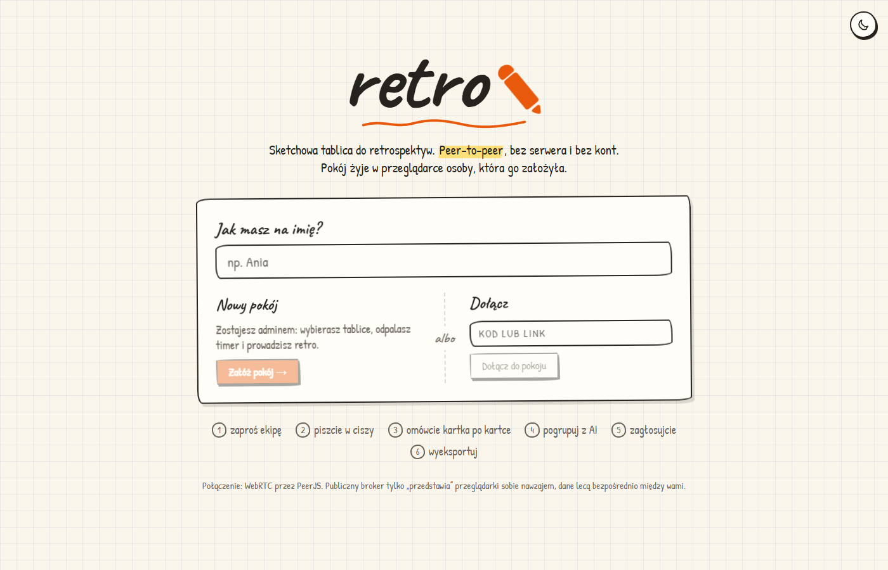
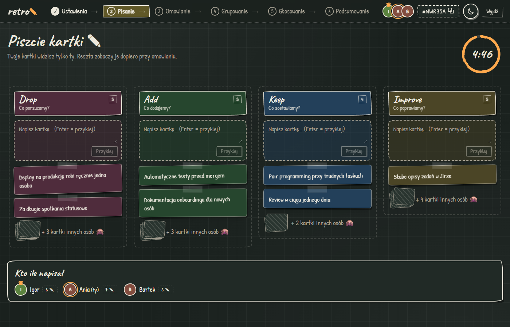
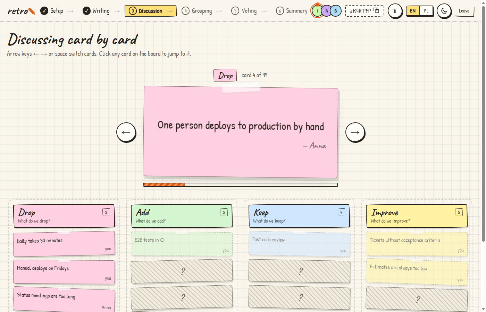
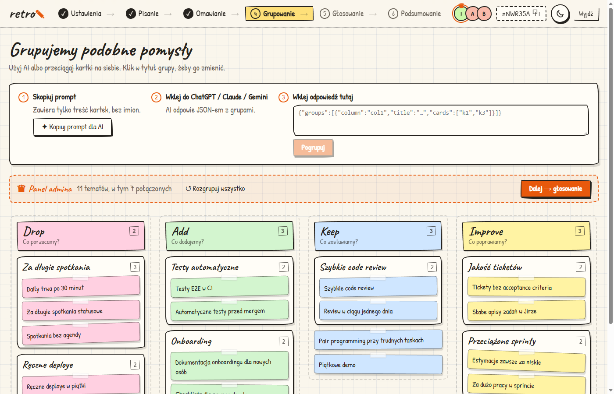
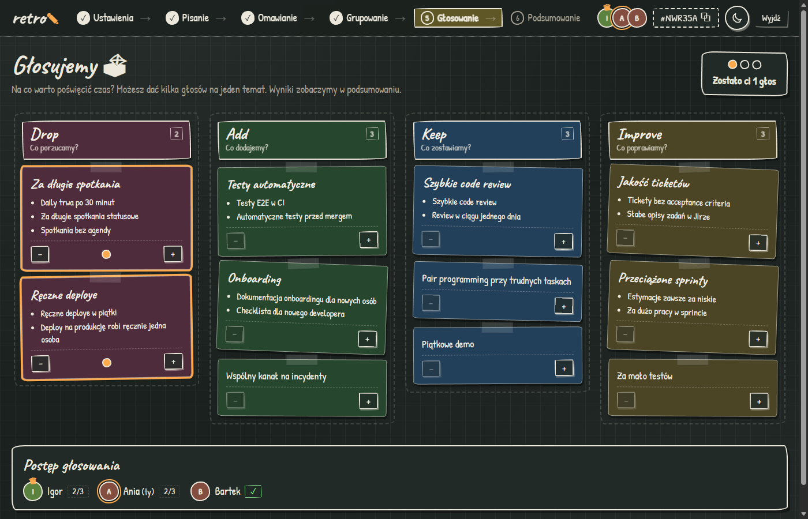

# retro ✎

Sketchowa tablica do retrospektyw, która działa **peer-to-peer** (WebRTC). Nie ma backendu: pokój żyje w przeglądarce osoby, która go założyła (admina), a reszta łączy się z nią bezpośrednio. Gdy sieć nie pozwala na połączenie bezpośrednie (np. internet mobilny za CGNAT), ruch idzie przez publiczny broker MQTT, zaszyfrowany kluczem z kodu pokoju. Szczegóły i diagramy: `#/info` w aplikacji.

**👉 Wypróbuj: https://igorovh.github.io/retro/**


## Flow

1. **Ustawienia**: admin wybiera tablice (Drop/Add/Keep/Improve, Start/Stop/Continue, Mad/Sad/Glad, 4L, Żaglówka albo własne), czas pisania i liczbę głosów. Reszta wchodzi linkiem `…/#/KOD`.
2. **Pisanie**: startuje timer. Admin może dorzucić lub odjąć czas albo go zapauzować. Każdy widzi tylko swoje kartki, cudze są zakryte.
3. **Omawianie**: kartki odkrywają się po kolei w dużym widoku (kolumna po kolumnie, osoba po osobie). Admin przełącza je strzałkami.
4. **Grupowanie**: „Kopiuj prompt dla AI” → wklejasz do ChatGPT/Claude → odpowiedź (JSON) wklejasz z powrotem i kartki układają się w grupy. Można też przeciągać kartki ręcznie.
5. **Głosowanie**: dot-voting, kilka głosów można dać na jeden temat.
6. **Podsumowanie**: ranking tematów, eksport do tekstu (kopiuj / `.txt`) i prompt do wygenerowania action items.

Tryb jasny (papier w kratkę) i ciemny (tablica kredowa) przełączasz ikoną słońca/księżyca.

## Jak to wygląda

| | |
|---|---|
|  |  |
| **Start**: imię, nowy pokój albo dołączenie kodem | **Pisanie**: cudze kartki są zakryte, timer odlicza czas |
|  |  |
| **Omawianie**: kartka po kartce na pierwszym planie | **Grupowanie**: odpowiedź AI układa powtarzające się pomysły w grupy |
|  |  |
| **Głosowanie**: dot-voting z podglądem, kto już zagłosował | **Podsumowanie**: ranking i eksport |

## Uruchomienie lokalnie

```bash
npm install
npm run dev      # http://localhost:5173
npm run build    # statyczne pliki w dist/
```

`dist/` to czysty statyk (`base: './'`), więc wrzucisz go na GitHub Pages, Netlify, Cloudflare Pages albo dowolny hosting plików. To repo publikuje się na GitHub Pages automatycznie po każdym pushu na `main` (`.github/workflows/deploy.yml`).

## Jak to działa

- **PeerJS** + darmowy publiczny broker `0.peerjs.com` służą tylko do zestawienia połączenia (signaling). Dane kartek lecą bezpośrednio między przeglądarkami.
- Topologia gwiazdy: admin trzyma pełny stan i każdemu wysyła przefiltrowany widok, więc ukryte kartki naprawdę nie trafiają do innych przeglądarek przed omawianiem.
- Stan admina zapisuje się w `localStorage`. Po odświeżeniu strony pokój wraca, a goście łączą się ponownie sami.
- Jeśli admin zamknie kartę, pokój jest offline do jego powrotu. Ekran łączenia ma opcję „Przywróć pokój jako admin”.
- Gdy WebRTC się nie zestawi (symetryczny NAT, CGNAT, firewall), gość po ~10 s przechodzi na relay przez publiczny broker MQTT (EMQX lub HiveMQ). Admin nasłuchuje na obu drogach. Wiadomości są szyfrowane AES-GCM kluczem wyprowadzonym z kodu pokoju (PBKDF2), więc broker widzi tylko szyfrogram. `?relay=1` w adresie wymusza relay (do testów).

## Licencja

[MIT](LICENSE)
