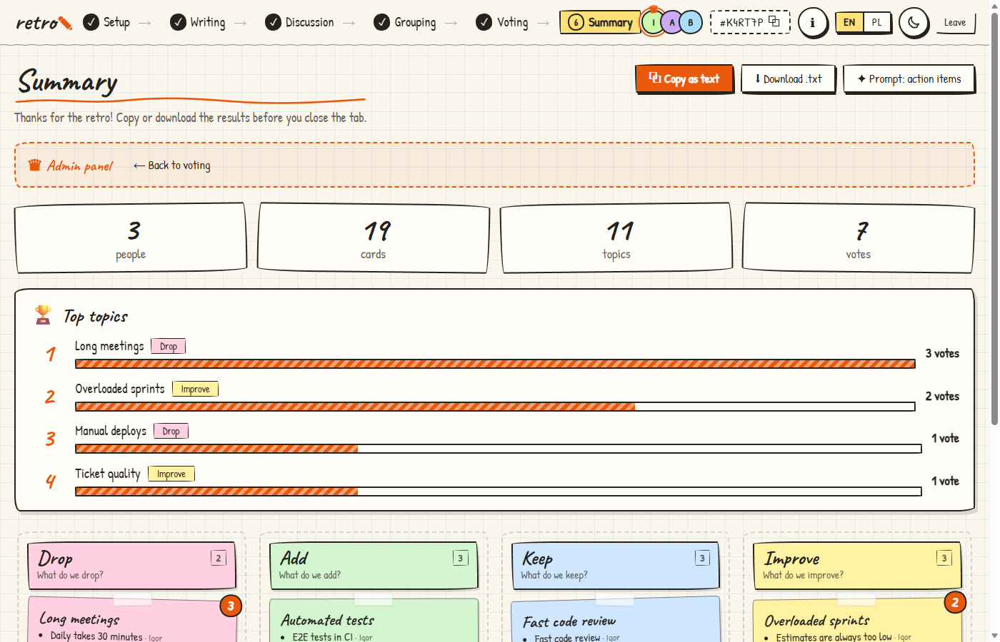
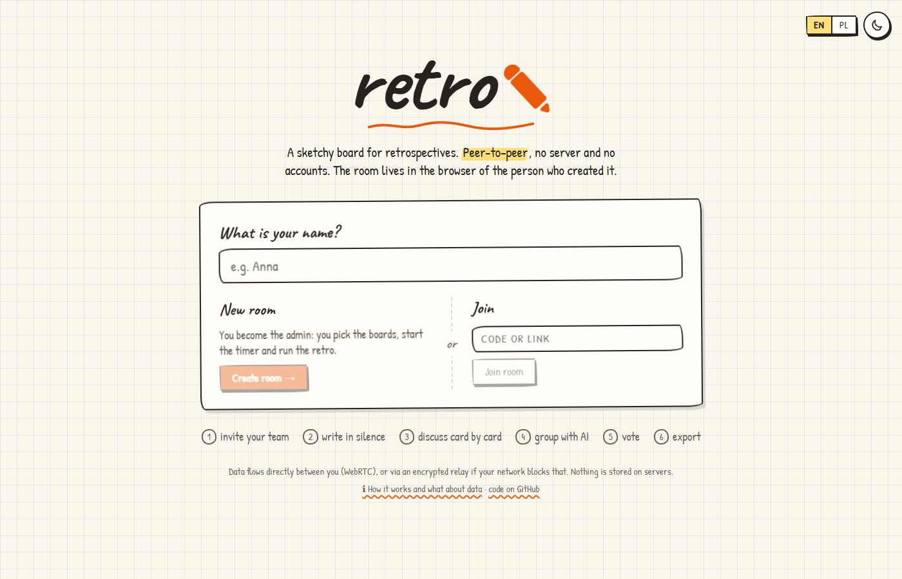
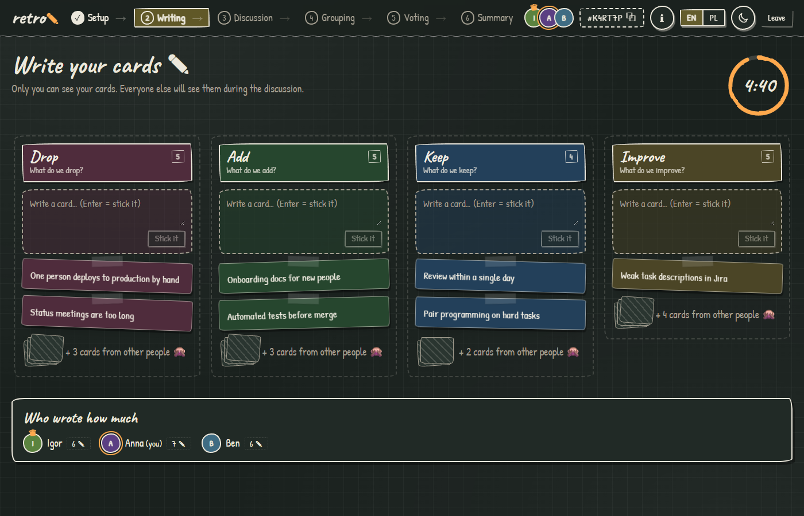
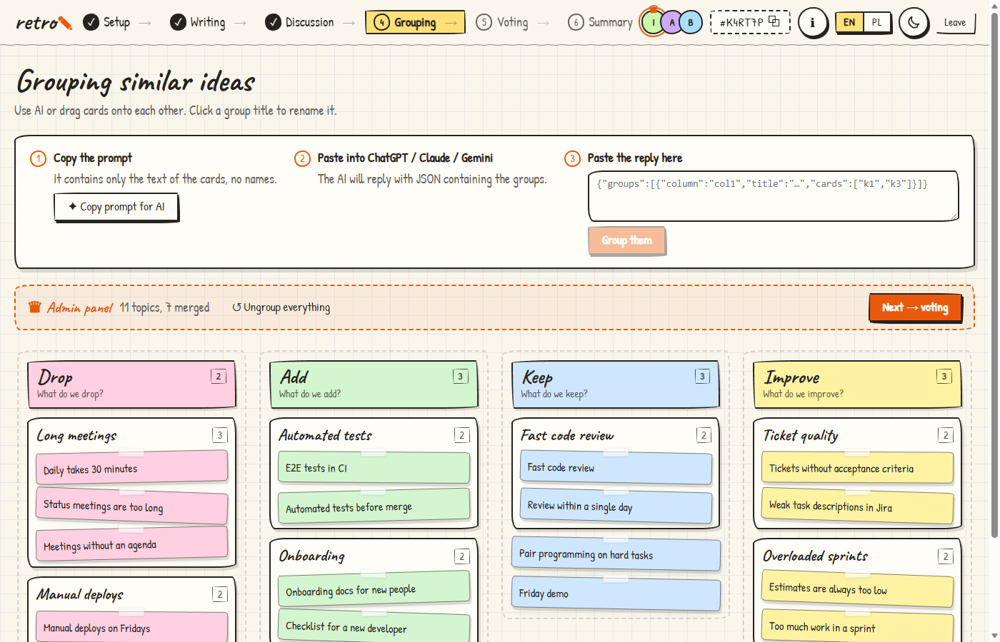
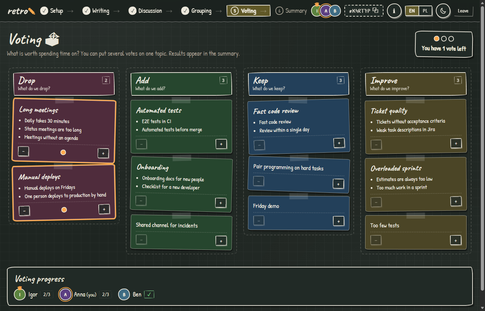

# retro ✎

A sketchy retrospective board that works **peer-to-peer** (WebRTC). No accounts, no analytics and no custom backend. The room lives in its creator's browser. If a direct connection fails, messages go through a public MQTT broker, encrypted with a key derived from the room code.

**👉 Try it: https://igorovh.github.io/retro/**

The interface supports **English and Polish**, with automatic language selection and an EN / PL switch. See [how it works](https://igorovh.github.io/retro/#/info) for data-flow diagrams and privacy details.



## Flow

1. **Setup:** the admin picks a template (Drop/Add/Keep/Improve, Went well/Went poorly/Actions, Start/Stop/Continue, Mad/Sad/Glad, 4L or Sailboat), or creates custom columns. Set the writing time and votes per person. Everyone joins through `…/#/CODE`.
2. **Writing:** the timer starts. The admin can add time, subtract time or pause. Each participant sees only their own cards.
3. **Discussion:** cards are revealed one at a time, by column and author. The admin moves between cards with arrow keys or the space bar.
4. **Grouping:** copy the AI prompt, paste it into ChatGPT/Claude/Gemini, then paste the JSON reply back into the app. Or group cards manually by dragging them.
5. **Voting:** dot voting, with multiple votes allowed on one topic.
6. **Summary:** ranked topics, text export (clipboard or `.txt`) and a prompt for generating action items.

Switch between light mode (graph paper) and dark mode (chalkboard) with the sun/moon button.

## Screenshots

| | |
|---|---|
|  |  |
| **Home:** enter your name, create a room or join with a code | **Writing:** other people's cards are hidden while the timer counts down |
|  |  |
| **Discussion:** one card at a time in the spotlight | **Grouping:** an AI reply groups similar ideas |
|  |  |
| **Voting:** dot voting with progress per participant | **Summary:** ranked topics and export |

## Local development

Use Node.js 22.18+ or 24+.

```bash
npm install
npm run dev      # http://localhost:5173
npm test         # language detection, dictionaries and plural rules
npm run build    # type-check and build static files in dist/
```

`dist/` contains static files (`base: './'`). Deploy it to GitHub Pages, Netlify, Cloudflare Pages or any static hosting service. This repository deploys to GitHub Pages on every push to `main` through [the deployment workflow](.github/workflows/deploy.yml).

## Languages

- Polish is selected if any preferred browser language is Polish or the browser's time zone is `Europe/Warsaw`. Otherwise, the app uses English. This is a local hint, not a location check: no IP lookup or geolocation permission is needed.
- The EN / PL switch remembers your choice in `localStorage`. Each participant can use their own interface language, even within the same room.
- `?lang=en` and `?lang=pl` override automatic selection for testing. Using the switch removes that override and saves your choice. Invite links do not pass the language override to guests.
- AI prompts, text exports, connection messages and the information page follow your interface language.
- Column titles and hints are stored as room content in the language used when the admin selects a template. Switching the interface language does not rewrite columns, cards or group titles.
- Translations live in [`src/i18n/en.ts`](src/i18n/en.ts) and [`src/i18n/pl.ts`](src/i18n/pl.ts). TypeScript checks the keys. Tests check placeholder consistency, language detection and plural forms.

## How it works

- **PeerJS** and the public server `0.peerjs.com` handle signaling. Once connected, browsers exchange room data directly over encrypted WebRTC.
- The admin holds the full state and sends a filtered view to each participant. Unrevealed card text is not sent to other guests, but it is held by the admin's browser.
- The admin's browser saves the room in `localStorage`. Refreshing restores it, and guests reconnect. Saved rooms older than 14 days since their last update are removed when the app starts.
- If the admin closes the tab, the room stays offline until they return. The connection screen offers **Restore room as admin** when that browser has a saved copy.
- If WebRTC fails (symmetric NAT, CGNAT or a firewall), the guest falls back to a public MQTT broker (EMQX or HiveMQ). An ICE connection timeout triggers fallback after about 10 seconds. The admin listens on both transports. Relay messages use AES-GCM with a key derived from the room code through PBKDF2. Anyone with the code can join, so keep it private.
- Public signaling and relay services are external dependencies, not guaranteed infrastructure. Relay ports 8084 and 8884 may still be blocked by restrictive networks. `?relay=1` forces the relay for testing.
- AI grouping is optional. Nothing is sent to an AI automatically: you choose whether and where to paste the prompt.

## License

[MIT](LICENSE)
